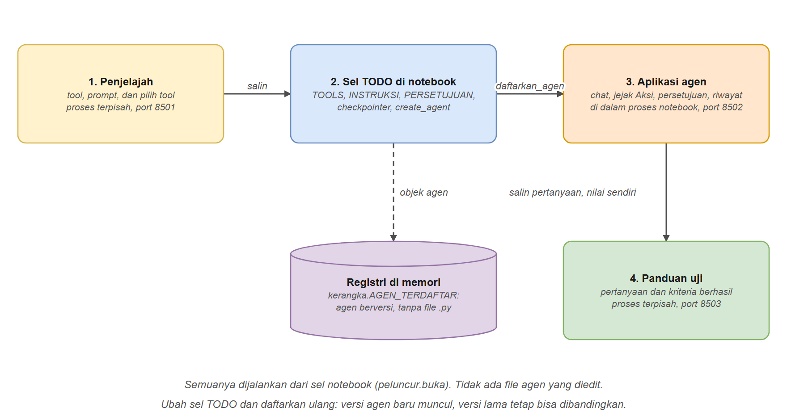
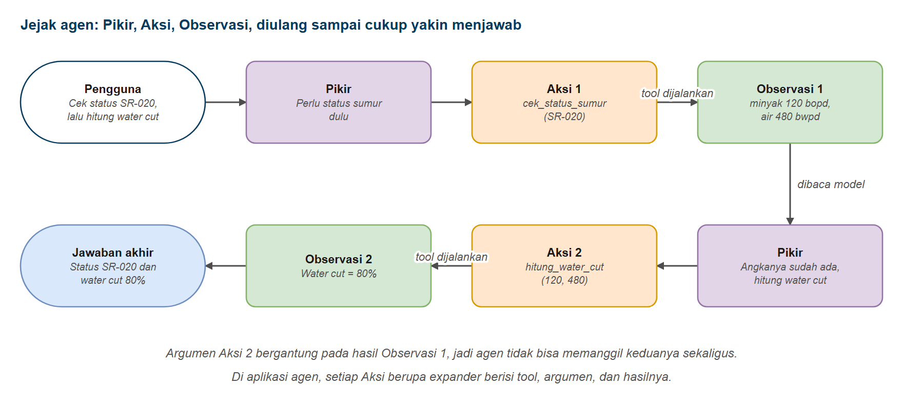
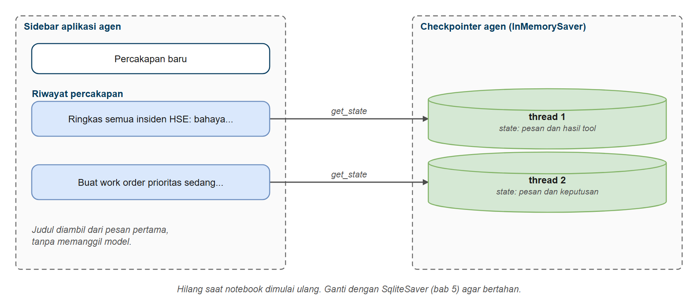
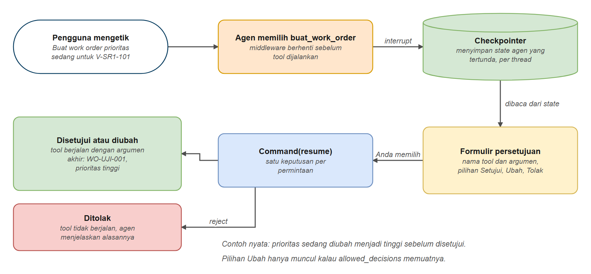

# Mini Project: Menyusun Agen dari Tiga Komponen

Di bab terakhir ini Anda tidak belajar fitur baru. Anda memakai semua yang sudah dipelajari (tool, agen, memori, streaming, persetujuan manusia, guardrails, dan pencarian dokumen) untuk menyusun **agen sederhana, secara mandiri atau berkelompok**.

Kami menyediakan komponennya, dan semuanya dikerjakan dari satu notebook. Ada **katalog 24 tool** untuk empat use case (Operasi, Perawatan, HSE, Engineering), **bank variasi prompt**, dan **tiga aplikasi Streamlit**: **Penjelajah** untuk mengenal tool dan prompt, **Aplikasi agen** untuk mengobrol dengan agen Anda (lengkap dengan jejak kerja agen dan formulir persetujuan), dan **Panduan uji** berisi pertanyaan beserta kriteria berhasil. Tugas Anda (atau kelompok Anda): memilih use case, lalu menyusun satu agen dari tiga komponen: **tool**, **prompt**, dan **interrupt** (persetujuan manusia). Agen ditulis di sel notebook, tanpa mengedit file `.py`.

## Latar Belakang: PT Minyak Sejahtera

Semua data di bab ini berasal dari **PT Minyak Sejahtera**, perusahaan migas fiktif yang dibuat untuk pelatihan. Perusahaan ini mengoperasikan tiga area lapangan dengan total **196 sumur**:

| Area | Gathering station | Jumlah sumur |
|------|-------------------|--------------|
| Seruni | GS-SR1 | 62 |
| Kenanga | GS-KN1, GS-KN2 | 86 |
| Melati | GS-ML1 | 48 |

Semua sumur diangkat dengan pompa: 89 ESP, 86 SRP, dan 21 PCP. Per 31 Juli 2026, 168 sumur berproduksi, 11 shut-in, 11 menunggu pulling, dan 6 sedang workover. Data operasinya mencakup **Juli 2026**: produksi harian setiap sumur, laporan harian operasi GS-SR1 (hanya area Seruni yang punya laporan stasiun), 400 work order pemeliharaan, 120 laporan insiden HSE, dan 31 dokumen (SOP, manual, laporan bulanan, lessons learned, dan laporan investigasi).

Empat peran di perusahaan ini punya kebutuhan data yang berbeda: pengawas shift operasi, perencana pemeliharaan, HSE officer, dan engineer lapangan. Keempatnya menjadi use case bab ini. Seluruh nama, angka, dan kejadian dibuat untuk pelatihan dan tidak mewakili perusahaan atau lapangan nyata.

## Prasyarat

- Sudah menyelesaikan [Agen dengan create_agent()](../../hari3/03-agen/README.md), [Memori Agen](../../hari3/05-memori-agen/README.md), dan [Persetujuan Manusia](../../hari3/06-persetujuan-manusia/README.md)
- Membantu: [Streaming Agen](../../hari3/bonus-streaming-agen/README.md) (bab bonus), [Guardrails dan Middleware Keamanan](../../hari3/07-guardrails-middleware/README.md), dan [RAG Agentik](../10-agentic-rag/README.md) (pencarian dokumen)
- Streamlit terpasang (sudah termasuk di `requirements.txt`)

## Tujuan Pembelajaran

Setelah bab ini Anda bisa:

- Menjelaskan tiga hal yang menentukan use case layak dikerjakan: data, integrasi, dan keamanan
- Mengenali tool (parameter, hasil, dan errornya) dan mengujinya langsung tanpa model
- Menyusun prompt agen dari peran, aturan tool, dan gaya jawaban, lalu membandingkan variasinya
- Menentukan tool tulis mana yang diberi interrupt, dan keputusan apa yang diizinkan reviewer
- Merakit tool, prompt, interrupt, dan checkpointer menjadi satu agen dengan `create_agent()`
- Membaca jejak kerja agen (Pikir, Aksi, Observasi) untuk memahami mengapa agen menjawab seperti itu
- Menguji agen dengan pertanyaan berkriteria, termasuk pertanyaan negatif, lalu memperbaiki komponen yang menjadi penyebabnya

---

## Komponen yang Disediakan

| Komponen | Isi |
|----------|-----|
| Tiga aplikasi Streamlit dan `kerangka.py` | Sudah jadi, tidak diubah |
| Katalog tool di `alat_data.py` | Dijelajahi lewat aplikasi Penjelajah |
| `TOOLS` | Fungsi yang boleh dipanggil agen (pilihan Anda) |
| `system_prompt` | Peran dan aturan agen |
| `interrupt_on` | Tool yang menunggu persetujuan manusia |
| Panduan uji | Pertanyaan dan kriteria yang Anda nilai sendiri |

Semua use case memakai aplikasi dan kerangka yang sama, sehingga hasilnya bisa dibandingkan dengan adil.

---

## Alur Mini Project

| Tahap | Yang dikerjakan | Hasil |
|-------|-----------------|-------|
| 1. Pilih | Menjawab tiga pertanyaan: data, integrasi, keamanan | Satu use case terpilih beserta alasannya |
| 2. Jelajahi | Mengenal tool dan membangun prompt di aplikasi Penjelajah | `TOOLS` dan teks system prompt yang siap disalin |
| 3. Rakit | Mengisi tiga TODO di sel notebook (tool, checkpointer, `create_agent`) dan mendaftarkan agen | Agen yang tampil di aplikasi agen |
| 4. Mengobrol | Memakai aplikasi agen, membaca jejak, mencoba persetujuan | Pemahaman cara agen memilih tool |
| 5. Uji | Menjalankan pertanyaan dari Panduan uji, menilai kriteria, memperbaiki | Agen yang lebih baik dan alasannya |



*Gambar 1. Tiga aplikasi Streamlit dan sel TODO di notebook*

---

## Isi Folder Bab

```text
hari4/11-mini-project/
  aplikasi/
    penjelajah.py      aplikasi 1: tool dan prompt (tidak diubah)
    app.py             aplikasi 2: chat dengan agen, jejak, persetujuan (tidak diubah)
    panduan_uji.py     aplikasi 3: pertanyaan dan kriteria berhasil (tidak diubah)
    kerangka.py        menjalankan agen, membaca state, registri agen (tidak diubah)
    peluncur.py        menyalakan ketiga aplikasi dari sel notebook
    alat_data.py       KATALOG tool: work order, insiden HSE, laporan harian, setpoint VSD, pencarian dokumen
    prompt_bank.py     variasi prompt dan kumpulan pertanyaan per use case
    info_tool.py, ilustrasi.py, bank_uji.py   isi penjelajah dan panduan uji
  code/                lima contoh kode bab ini (sel notebook)
  solusi/              kunci jawaban: agen_saya.py (TODO terisi), agen_contoh/ dan alat uji untuk fasilitator
  lembar_rancangan.md  lembar rancangan (diisi sendiri atau bersama kelompok)
```

Semua aplikasi dinyalakan dari sel notebook dengan `peluncur.buka(...)`, dan tautannya muncul di bawah sel. Di Google Colab tautan itu membuka aplikasi di tab baru, dan aplikasinya juga tampil langsung di bawah sel. Sebelum menyusun apa pun, jalankan notebook dari atas dan coba penjelajah.

> **Pertama kali memakai Streamlit di komputer sendiri**, terminal bisa menanyakan email. Tekan Enter untuk melewatinya. Dari notebook, pertanyaan itu tidak muncul.

---

## Bagian 1: Memilih Use Case

Use case yang baik bukan yang paling canggih. Cukup tiga pertanyaan yang dijawab jujur sebelum menulis kode:

| Hal | Pertanyaannya | Contoh yang baik | Contoh yang bermasalah |
|-----|---------------|------------------|------------------------|
| **Data** | Datanya sudah ada di tangan kita? | Riwayat work order: `data/raw/work_orders.csv` sudah ada | Prediksi kegagalan ESP dari data sensor: tidak ada file sensornya |
| **Integrasi** | Bisa disambungkan ke tool dalam waktu workshop? | Membaca file CSV lewat tool sederhana | Menulis ke sistem work order sungguhan: butuh akses dan izin dari tim TI |
| **Keamanan** | Apa akibatnya kalau agen salah? | Meringkas insiden HSE: salah pun tidak berbahaya | Mengubah setpoint VSD: salah bisa merusak pompa atau mengganggu produksi, jadi wajib persetujuan manusia |


*Gambar 2. Tiga syarat use case: data, integrasi, keamanan*

Use case yang berisiko tidak harus dibuang. Kalau kelompok tetap memilihnya, setiap tindakan tulis wajib lewat persetujuan manusia (komponen ke-3), dan sebaiknya reviewer tidak boleh mengubah argumennya. Sebaliknya, use case yang datanya belum ada sebaiknya ditunda, sebaik apa pun idenya.

Katalog di bab ini sudah menyiapkan data dan tool untuk empat use case. Tool tulis ditandai karena inilah yang perlu interrupt:

| Use case | Tool baca | Tool tulis (perlu interrupt) |
|----------|-----------|------------------------------|
| **Operasi**: pengawas shift GS-SR1 | `laporan_harian`, `ringkasan_produksi_bulanan`, `bandingkan_produksi`, `hari_berkejadian`, `cek_status_sumur`, `daftar_sumur`, `produksi_sumur`, `riwayat_work_order`, `cari_dokumen_sop`, `hitung_water_cut` | `catat_serah_terima` |
| **Perawatan**: perencana pemeliharaan | `riwayat_work_order`, `statistik_kegagalan`, `aset_downtime_tertinggi`, `cek_status_sumur`, `daftar_sumur`, `produksi_sumur`, `cari_dokumen_sop`, `cari_dokumen_manual` | `buat_work_order`, `tutup_work_order` |
| **HSE**: petugas HSE | `cari_insiden`, `ringkasan_insiden`, `cek_status_sumur`, `riwayat_work_order`, `cari_dokumen_sop`, `cari_dokumen_laporan`, `cari_dokumen_investigasi` | `usulkan_tindakan_korektif`, `kirim_notifikasi_hse` |
| **Engineering**: engineer lapangan | `cari_dokumen_sop`, `cari_dokumen_manual`, `cari_dokumen_laporan`, `konversi_satuan`, `hitung_water_cut`, `cek_status_sumur`, `daftar_sumur`, `produksi_sumur`, `riwayat_work_order` | `ubah_setpoint_vsd` |

Data sumur untuk ketiga tool sumur (`cek_status_sumur`, `daftar_sumur`, `produksi_sumur`) dan `ubah_setpoint_vsd` ada di folder `data/field/`: `sumur.csv` memuat 196 sumur Seruni, Kenanga, dan Melati dengan status per 31 Juli 2026, dan `produksi_sumur_2026-07.csv` memuat produksi harian tiap sumur selama Juli 2026. Jumlah produksi semua sumur Seruni pada satu hari sama dengan laporan harian GS-SR1, jadi hasil `laporan_harian` dan `produksi_sumur` bisa saling dicocokkan. Untuk empat tool pencarian dokumen, korpus dokumen hari 2 sampai 4 (`data/docs`, 13 dokumen) ditambah 18 dokumen khusus bab ini di `data/docs_bab11` (SOP keselamatan dan operasi, manual ESP, pumping unit, dan level control valve, laporan bulanan Kenanga dan Melati, lessons learned, dan satu laporan investigasi), sehingga ada 31 dokumen. Dokumen tambahan dipisah supaya bab lain tidak terpengaruh, dan indeksnya dibangun terpisah pada pencarian pertama (sekitar setengah menit). Semua datanya fiktif.

Keempat use case memakai data dan dokumen perusahaan yang sama, sehingga tool-nya sengaja saling terhubung: kode sumur (misalnya `SR-014`) juga kode aset pada work order, nomor insiden menghubungkan data insiden dengan tindakan korektif, dan SOP, manual, serta laporan dipakai bersama. Karena itu satu pertanyaan bisa melintasi beberapa tool (multistep), misalnya dari laporan harian ke produksi sumur ke riwayat work order. Tool tulis tetap hanya ada di use case pemiliknya.

Anda tidak harus mengikuti satu baris tabel. Boleh menggabungkan tool dari beberapa use case, atau menulis tool sendiri. Hasil pilihan kelompok ditulis di [lembar rancangan](./lembar_rancangan.md), satu halaman saja.

---

## Bagian 2: Tiga Komponen Agen

---

### Komponen 1: Tool

Tool adalah apa yang bisa dilakukan agen. Tool yang salah atau deskripsinya kabur tidak bisa diselamatkan oleh agen sebesar apa pun, jadi **uji tool langsung dengan `.invoke()` sebelum memberikannya ke agen**. Tool tulis di bab ini hanya mencatat ke memori (`CATATAN_TINDAKAN`), tidak mengubah sistem nyata, sehingga aman dicoba berulang kali.

Pencarian dokumen dipecah menjadi satu tool per jenis dokumen: `cari_dokumen_sop`, `cari_dokumen_manual`, `cari_dokumen_laporan`, dan `cari_dokumen_investigasi`. Dengan begitu jelas dokumen apa yang bisa dibaca agen Anda. Laporan investigasi berstatus terbatas, jadi hanya agen yang dipasangi `cari_dokumen_investigasi` yang bisa menjawab dari laporan itu. Di sistem nyata, hak akses semacam ini berasal dari login pengguna, bukan dari pilihan tool.

---

### Contoh 1: Menjelajahi Tool dan Prompt

Contoh ini menyalakan aplikasi **Penjelajah** (Streamlit 1). Ia punya tiga tab:

- **Tool**: setiap tool punya ilustrasi sendiri, penjelasan fungsi dan sumber datanya, tabel parameter, bentuk hasil, contoh pemakaian, dan formulir **Coba sendiri** untuk memanggilnya langsung. Parameter dengan pilihan terbatas (misalnya `tingkat` atau `prioritas`) tampil sebagai dropdown. Tab **Sumber data** menunjukkan dari mana tool mengambil jawabannya: seluruh tabel CSV yang dibaca (dengan kolom yang dipakai tool, termasuk 196 sumur dan produksi harian per sumur), atau, untuk pencarian dokumen, dokumen asli beserta chunk hasil pemecahannya. Tab **Yang dilihat model** menunjukkan bahwa model hanya membaca nama, deskripsi, dan skema argumen.
- **Prompt**: memilih use case, aturan tool, dan satu atau lebih gaya jawaban, lalu menekan **Bangun prompt**. Hasilnya bisa disalin.
- **Pilih tool**: mencentang tool dan mendapatkan snippet kode `TOOLS`.

**Kode kunci yang dijalankan tombol "Jalankan tool":**

```python
@tool(parse_docstring=True)
def riwayat_work_order(asset_id: str, maks: int = 5) -> str:
    """Tampilkan riwayat work order sebuah aset: tanggal, kategori kegagalan, komponen, tindakan, dan downtime.

    Args:
        asset_id: Kode aset, contoh "SR-020" atau "V-SR1-101".
        maks: Jumlah work order terbaru yang ditampilkan (1 sampai 10).
    """
    ...

riwayat_work_order.invoke({"asset_id": "SR-020", "maks": 2})   # panggil langsung, tanpa model
```

**Kode**: [`code/01_penjelajah.py`](./code/01_penjelajah.py)

```python
# %% [markdown]
# # Contoh 1: Menjelajahi Tool dan Prompt
# Jalankan sel satu per satu dengan Shift+Enter, atau seluruh file: `python hari4/11-mini-project/code/01_penjelajah.py`
#
# Dua komponen pertama agen adalah tool dan prompt. Sebelum memilihnya, kenali dulu bahannya lewat aplikasi Streamlit
# **Penjelajah** (`aplikasi/penjelajah.py`):
#
# - tab **Tool**: 24 tool dengan ilustrasi, parameter, hasil, contoh pemakaian, dan formulir untuk memanggilnya sendiri
#   (parameter pilihan terbatas berupa dropdown) dan tab **Sumber data**: tabel CSV atau dokumen asli beserta chunk-nya
# - tab **Prompt**: memilih use case, aturan tool, dan gaya jawaban, lalu menekan **Bangun prompt**
# - tab **Pilih tool**: mencentang tool dan mendapatkan snippet kode `TOOLS` untuk disalin
#
# Aplikasi ini tidak memanggil model, jadi aman dan cepat dicoba berulang kali. Hasilnya Anda salin (copy-paste) ke sel
# TODO pada Contoh 3.

# %%
# Langkah 1 - Menyiapkan jalur modul bab ini dan indeks dokumen
import sys

from migas_shared.config import ROOT

sys.path.insert(0, str(ROOT / "hari4" / "11-mini-project" / "aplikasi"))

import alat_data as a
import peluncur

# Pencarian dokumen memakai indeks vektor. Dibangun sekali di sini (di sesi baru termasuk mengunduh model embedding,
# sekitar 1 menit), lalu dipakai ulang oleh penjelajah dan agen Anda.
a.retriever_bab11()
print("Indeks dokumen siap.")

# %% [markdown]
# ## Langkah 2 - Menjalankan penjelajah
# Sel di bawah menyalakan aplikasi di port 8501, lalu menampilkan tautan untuk membukanya di tab baru (di Google Colab
# tautan muncul di bawah sel, dan aplikasinya juga tampil di dalam sel; tab baru lebih lega untuk dipakai). Menjalankan sel ini lagi tidak membuat aplikasi ganda.

# %%
peluncur.buka("penjelajah")

# %% [markdown]
# ## Langkah 3 - Yang perlu Anda coba di penjelajah
# 1. Buka tiga tool dari kelompok berbeda. Baca bagian **Parameter** dan **Yang dikembalikan**, lalu tekan **Jalankan tool**.
# 2. Buka `konversi_satuan` dan coba nilai `dari` serta `ke` yang tidak didukung. Perhatikan pesan errornya: pesan inilah yang nanti dibaca agen.
# 3. Buka satu tool **TULIS** (misalnya `buat_work_order`) dan jalankan. Lihat **Catatan tindakan di memori**: tool hanya mencatat, tidak mengubah sistem nyata.
# 4. Buka `cari_dokumen_investigasi` dan bandingkan dengan `cari_dokumen_sop`. Hanya satu tool yang bisa membaca laporan investigasi.
# 5. Buka **Yang dilihat model tentang tool ini**. Model tidak melihat kode tool; ia hanya membaca nama, deskripsi, dan skema argumen.
# 6. Di tab **Prompt**, bangun prompt untuk satu use case dengan dua gaya berbeda dan bandingkan hasilnya.
# 7. Buka tab **Sumber data** pada beberapa tool: lihat tabel CSV yang dibaca `riwayat_work_order`, lalu dokumen asli dan chunk dari `cari_dokumen_sop`. Jalankan pencariannya dan perhatikan chunk bertanda `[TERAMBIL]`.
# 8. Di tab **Pilih tool**, centang tool untuk agen yang ingin Anda buat. Biarkan tab ini terbuka sampai Contoh 3.

# %% [markdown]
# ## Langkah 4 - Tool yang sama, tanpa antarmuka
# Yang dilakukan tombol **Jalankan tool** hanyalah memanggil `.invoke({...})`. Kode ini sama persis dengan contoh pemakaian
# di penjelajah, dan menghasilkan teks yang sama dengan yang nanti dibaca agen sebagai observasi.

# %%
print(a.hitung_water_cut.invoke({"oil_bopd": 120, "water_bwpd": 480}))
print(a.riwayat_work_order.invoke({"asset_id": "SR-020", "maks": 2}))

# %% [markdown]
# ## Ide Utama
# - Agen hanya setajam tool dan deskripsinya: tool yang salah atau deskripsinya kabur tidak bisa diselamatkan agen sebesar apa pun
# - Uji tool lebih dulu dengan `.invoke({...})` tanpa model, seperti yang dilakukan tombol **Jalankan tool**
# - Tool BACA hanya mengambil data. Tool TULIS mengubah sesuatu dan di sistem nyata harus dipasangi persetujuan manusia (komponen 3)
# - Hak akses ditentukan oleh tool yang Anda pasang: hanya agen dengan `cari_dokumen_investigasi` yang bisa membaca laporan investigasi
# - Prompt dibangun dari tiga bahan: peran, aturan yang menyebut tool dengan namanya, dan gaya jawaban
```

### Keluaran yang Diharapkan

```text
Indeks dokumen siap.

Penjelajah tool dan prompt berjalan di http://localhost:8501

Water cut = 80.0% (total cairan 600 bpd)
SR-020: 5 work order, total downtime 25.0 jam. Terbaru:
- WO-26-10086 (2026-09-24): Instrumentation/Control, komponen VSD, tindakan Replace, downtime 4.0 jam
- WO-26-10320 (2026-06-18): Preventive Maintenance, komponen VSD, tindakan Adjust/Reset, downtime 3.0 jam
```

### Cara Kerjanya

1. **`peluncur.buka("penjelajah")`** menyalakan Streamlit di port 8501 sebagai proses terpisah dan menampilkan tautannya. Menjalankan sel itu lagi tidak membuat aplikasi ganda.
2. **Tombol "Jalankan tool" memanggil `.invoke({...})`.** Hasilnya teks yang sama dengan yang nanti dibaca agen sebagai observasi. Langkah 4 pada kode menunjukkan panggilan yang sama tanpa antarmuka.
3. **Masukan yang tidak dikenal menghasilkan pesan jelas**, misalnya "Tidak ada work order untuk aset XX-999". Agen akan menyampaikan pesan itu apa adanya, jadi pesannya harus ditulis agar bisa dipahami pengguna.
4. **Docstring adalah petunjuk bagi model.** Kalimat pertama menentukan kapan tool dipilih, dan bagian `Args` memberi contoh nilai. Tool baru buatan kelompok Anda ditulis dengan pola yang sama.
5. **Tool TULIS menambah catatan di memori** (`CATATAN_TINDAKAN`, nomor berawalan `-UJI-`). Daftar ini bisa dilihat dan dihapus dari halaman tool.
6. **Pilihan terbatas ditulis sebagai `Literal`.** Parameter seperti `tipe_peralatan`, `tingkat`, `bahaya`, dan `prioritas` bertipe `Literal[...]` pada tool. Skema argumen memuat daftar nilai yang sah (`enum`), jadi model tidak bisa mengarang nilai lain, nilai di luar daftar ditolak sebelum tool berjalan, dan penjelajah menampilkannya sebagai dropdown.
7. **Tab Sumber data memperlihatkan apa yang mungkin ditarik tool.** Tool CSV menampilkan seluruh tabelnya, tool dokumen menampilkan dokumen asli dan chunk-nya. Setelah menjalankan tool pencarian dokumen, chunk yang terambil ditandai `[TERAMBIL]`, dan dokumen revisi lama atau berakses terbatas terlihat tidak ikut terjangkau.

---

### Komponen 2: Prompt

`system_prompt` adalah peran dan aturan agen, berupa **teks biasa**. Anda bebas menulisnya dari nol. Untuk memulai cepat, tab **Prompt** di penjelajah menyediakan tiga bahan, menyusunnya menjadi satu teks, dan Anda tinggal menyalinnya ke `system_prompt=` pada `create_agent(...)`. Tidak ada fungsi khusus yang dipanggil di notebook: yang dibaca model hanyalah teksnya.

- **Peran**: satu kalimat peran untuk tiap use case
- **Aturan tool**: daftar aturan yang menyebut tool dengan namanya (misalnya "untuk tanggal tertentu, SELALU panggil `laporan_harian` dulu"); tiap aturan bisa dicentang sendiri
- **Gaya jawaban**: variasi cara agen menjawab, boleh dicampur

| Gaya | Isinya | Cocok untuk |
|------|--------|-------------|
| `minimal` | Hanya peran, tanpa aturan | Pembanding: lihat apa yang terjadi tanpa aturan |
| `ketat` | Hanya dari tool, tolak yang di luar cakupan, jangan mengarang | Data operasi yang tidak boleh meleset |
| `ramah` | Nada santai, menawarkan satu langkah lanjutan tanpa menjalankannya | Asisten untuk pengguna lapangan |
| `tabel` | Perbandingan dan daftar dalam tabel, ditutup satu kalimat kesimpulan | Laporan untuk manajemen |
| `sitasi` | Setiap fakta dokumen diberi sitasi `[DOC_ID bagian]` | Agen yang memakai tool `cari_dokumen_*` |
| `hati_hati` | Tool tulis hanya bila diminta jelas, tanyakan dulu bila ada yang kurang | Agen yang punya tool tulis |

Teks hasil penjelajah boleh diubah: tambah kalimat sendiri, hapus aturan yang tidak perlu, atau tulis ulang seluruhnya. Aturan yang menyebut sebuah tool hanya berguna bila tool itu ada di `tools`. Prompt yang menyuruh agen memakai tool yang tidak ia miliki membuat agen bingung atau berpura-pura. Penjelajah memberi peringatan bila prompt menyebut tool yang belum Anda pilih.

> **Prompt tidak selalu berlaku bagi model.** Aturan "jangan memanggil tool tulis tanpa diminta" hanya imbauan. Yang benar-benar menjamin sebuah tindakan tidak berjalan sebelum disetujui adalah komponen ke-3.

---

### Komponen 3: Interrupt

`HumanInTheLoopMiddleware` dipasang pada parameter `middleware` di `create_agent(...)`. Parameter `interrupt_on` berisi kamus dari nama tool ke keputusan yang diizinkan reviewer. Tool yang ada di kamus ini berhenti menunggu manusia sebelum berjalan (mekanismenya dari [bab 6](../../hari3/06-persetujuan-manusia/README.md)). Tool yang tidak ada di kamus berjalan bebas. Anda sendiri yang menuliskannya, dan Anda sendiri yang mengamati akibatnya di aplikasi agen.

```python
middleware=[
    HumanInTheLoopMiddleware(
        interrupt_on={
            "buat_work_order": {"allowed_decisions": ["approve", "edit", "reject"]},
            "kirim_notifikasi_hse": {"allowed_decisions": ["approve", "reject"]},
        }
    )
],
```

Memilih keputusan yang diizinkan adalah keputusan tentang risiko:

| Jenis tool tulis | Contoh | Keputusan yang diizinkan | Alasan |
|------------------|--------|--------------------------|--------|
| Argumen bisa diperbaiki reviewer | `buat_work_order` (prioritas, uraian), `ubah_setpoint_vsd` (nilai Hz) | `approve`, `edit`, `reject` | Reviewer sering ingin memperbaiki sedikit, bukan menolak seluruhnya |
| Tidak boleh diubah, hanya boleh jalan atau tidak | `kirim_notifikasi_hse`, `usulkan_tindakan_korektif` | `approve`, `reject` | Pesan yang terkirim tidak bisa ditarik; yang disetujui harus persis yang dilihat |
| Tidak ada yang boleh berjalan tanpa tinjauan khusus | tindakan yang menghentikan produksi | `reject` saja, atau jangan sediakan tool-nya | Lebih aman tidak memberikan tool sama sekali |

Formulir di aplikasi agen hanya menampilkan pilihan yang ada di `allowed_decisions`. Kalau `edit` tidak diizinkan, pilihan **Ubah** tidak muncul. Notebook tidak memeriksa pilihan Anda: kalau sebuah tool tulis lupa dicantumkan, ia akan berjalan tanpa formulir, dan Panduan uji menyediakan pertanyaan untuk memperlihatkannya.

---

### Contoh 2: Merakit Agen dengan create_agent

Contoh ini hanya memperlihatkan **cara merakit** agen, langkah demi langkah: empat tool Operasi (tiga baca dan satu tulis), teks system prompt, checkpointer, lalu `create_agent(...)` dengan `HumanInTheLoopMiddleware`. Tidak ada pertanyaan yang diajukan; Anda mengobrol dengan agen di Contoh 4.

**Kode**: [`code/02_rakit_agen.py`](./code/02_rakit_agen.py)

```python
# %% [markdown]
# # Contoh 2: Merakit Agen dengan create_agent
# Jalankan sel satu per satu dengan Shift+Enter, atau seluruh file: `python hari4/11-mini-project/code/02_rakit_agen.py`
#
# Sebuah agen dirakit dengan satu panggilan `create_agent(...)`. Yang Anda tentukan:
#
# 1. `tools`: tool apa yang boleh dipakai agen (dari penjelajah di Contoh 1)
# 2. `system_prompt`: peran dan aturan agen, berupa teks biasa
# 3. `middleware`: `HumanInTheLoopMiddleware(interrupt_on={...})` untuk tool yang harus menunggu persetujuan manusia (bab 6)
# 4. `checkpointer`: penyimpan keadaan agen, supaya percakapan diingat dan agen bisa berhenti menunggu keputusan (bab 5)
#
# Contoh ini merakit agen untuk use case Operasi. Di Contoh 3 Anda merakit agen Anda sendiri dengan cara yang sama.

# %%
# Langkah 1 - Mengimpor bahan perakitan
import sys

from langchain.agents import create_agent
from langchain.agents.middleware import HumanInTheLoopMiddleware
from langgraph.checkpoint.memory import InMemorySaver

from migas_shared.config import ROOT
from migas_shared.llm import get_chat_model

sys.path.insert(0, str(ROOT / "hari4" / "11-mini-project" / "aplikasi"))

import alat_data as a
import kerangka as k

# %% [markdown]
# ## Langkah 2 - Tool
# Empat tool dari katalog Operasi: tiga tool baca dan satu tool tulis. Tool dipilih di penjelajah lalu ditempel sebagai `import`.

# %%
from alat_data import (
    laporan_harian,
    cek_status_sumur,
    hitung_water_cut,
    catat_serah_terima,
)

TOOLS = [laporan_harian, cek_status_sumur, hitung_water_cut, catat_serah_terima]
for t in TOOLS:
    print(f"   [{a.jenis_tool(t):<5}] {t.name}")

# %% [markdown]
# ## Langkah 3 - System prompt
# System prompt adalah teks biasa yang diteruskan ke `system_prompt=`. Di bab ini teksnya disalin dari tab **Prompt** di penjelajah,
# lalu boleh diubah sesuka Anda.

# %%
system_prompt = """Anda asisten pengawas shift di gathering station GS-SR1.
Jawab dari laporan harian atau status sumur, dan pakai hitung_water_cut untuk water cut.
Untuk pertanyaan tentang tanggal tertentu, SELALU panggil laporan_harian dulu.
Catat serah terima hanya bila pengguna memintanya dengan jelas.
Jangan mengarang angka. Jika tool tidak menemukan data, katakan terus terang. Jawab dalam Bahasa Indonesia, ringkas."""
print(system_prompt)

# %% [markdown]
# ## Langkah 4 - Checkpointer
# `InMemorySaver` menyimpan keadaan agen di memori. Tanpa checkpointer, agen tidak ingat percakapan sebelumnya dan tidak bisa berhenti
# menunggu keputusan manusia lalu melanjutkan.

# %%
checkpointer = InMemorySaver()

# %% [markdown]
# ## Langkah 5 - Merakit agen
# Semuanya masuk ke `create_agent(...)`. Parameter `interrupt_on` pada `HumanInTheLoopMiddleware` adalah kamus dari nama tool ke
# keputusan yang diizinkan reviewer: `approve` (setuju), `edit` (ubah argumen), dan `reject` (tolak). Di sini hanya `catat_serah_terima`
# yang menunggu persetujuan, dan reviewer tidak boleh mengubah isinya. Tool yang tidak ada di kamus berjalan bebas.

# %%
agen = create_agent(
    get_chat_model(),
    tools=TOOLS,
    system_prompt=system_prompt,
    middleware=[
        HumanInTheLoopMiddleware(
            interrupt_on={
                "catat_serah_terima": {"allowed_decisions": ["approve", "reject"]},
            }
        )
    ],
    checkpointer=checkpointer,
)
print(f"Agen siap. Tool terpasang: {k.nama_tool_agen(agen)}")

# %% [markdown]
# ## Ide Utama
# - Agen = `create_agent(model, tools, system_prompt, middleware, checkpointer)`: semua yang dibutuhkan ada dalam satu panggilan
# - `system_prompt` hanyalah teks; yang Anda tulis di sana adalah imbauan bagi model
# - `interrupt_on` menentukan tool mana yang berhenti menunggu manusia, dan keputusan apa yang diizinkan
# - Checkpointer menyimpan keadaan agen di setiap langkah, sehingga percakapan dan permintaan persetujuan yang tertunda tidak hilang
```

### Keluaran yang Diharapkan

```text
   [baca ] laporan_harian
   [baca ] cek_status_sumur
   [baca ] hitung_water_cut
   [tulis] catat_serah_terima

Anda asisten pengawas shift di gathering station GS-SR1.
Jawab dari laporan harian atau status sumur, dan pakai hitung_water_cut untuk water cut.
Untuk pertanyaan tentang tanggal tertentu, SELALU panggil laporan_harian dulu.
Catat serah terima hanya bila pengguna memintanya dengan jelas.
Jangan mengarang angka. Jika tool tidak menemukan data, katakan terus terang. Jawab dalam Bahasa Indonesia, ringkas.

Agen siap. Tool terpasang: ['laporan_harian', 'cek_status_sumur', 'hitung_water_cut', 'catat_serah_terima']
```

### Cara Kerjanya

1. **`create_agent()` menerima semua yang dibutuhkan agen** dalam satu panggilan: model, `tools`, `system_prompt`, `middleware`, dan `checkpointer`.
2. **Tool** dipilih di penjelajah, lalu snippet `from alat_data import (...)` dan `TOOLS = [...]` ditempel di sel.
3. **System prompt** hanyalah string. Teksnya disalin dari penjelajah atau ditulis sendiri, lalu diteruskan ke `system_prompt=`.
4. **`interrupt_on`** hanya mencantumkan `catat_serah_terima`, tool tulis satu-satunya. Tiga tool baca tidak tercantum, jadi berjalan bebas.
5. **Checkpointer** (`InMemorySaver()`) menyimpan keadaan agen di memori. Tanpanya, agen tidak ingat percakapan dan tidak bisa berhenti menunggu keputusan lalu melanjutkan.

---

## Bagian 3: Merakit dan Menjalankan Agen Anda

---

### Contoh 3: Merakit Agen Anda Sendiri (TODO)

Sekarang giliran Anda. Contoh ini berisi kerangka dengan tiga TODO. Isi dari atas ke bawah, memakai hasil penjelajah dan cara merakit di Contoh 2:

| TODO | Yang diisi |
|------|------------|
| `TODO(M.1)` | `TOOLS`: daftar tool yang boleh dipakai agen (tempel dari penjelajah) |
| `TODO(M.2)` | `checkpointer`: penyimpan percakapan dan keadaan agen |
| `TODO(M.3)` | `agen`: panggilan `create_agent(...)`, termasuk teks `system_prompt` dan `HumanInTheLoopMiddleware(interrupt_on=...)` |

Prompt dan persetujuan tidak punya variabel tersendiri: Anda menuliskannya langsung di dalam `create_agent(...)`. Notebook tidak menilai pilihan Anda. Tool tulis yang lupa dipasangi interrupt, prompt yang kurang tegas, atau tool yang kurang, semuanya akan terlihat sendiri sebagai reaksi agen di Contoh 4 dan 5. Sel `Periksa` hanya melihat apakah TODO sudah terisi dan tool apa yang benar-benar terpasang. Kunci jawaban ada di bagian **Kode Jawaban Latihan** pada akhir PDF bab ini; buka hanya bila Anda buntu.

**Kode**: [`code/03_agen_saya.py`](./code/03_agen_saya.py)

**Kode lengkap (kerangka TODO):**

```python
# %% [markdown]
# # Contoh 3: Merakit Agen Anda Sendiri (TODO)
# Jalankan sel satu per satu dengan Shift+Enter, atau seluruh file: `python hari4/11-mini-project/code/03_agen_saya.py`
#
# Sekarang giliran Anda. Bahannya sudah Anda kenal di penjelajah (Contoh 1) dan cara merakitnya sudah Anda lihat di Contoh 2.
# Isi tiga TODO di bawah, dari atas ke bawah:
#
# | TODO | Yang diisi |
# |---|---|
# | `TODO(M.1)` | `TOOLS`: daftar tool yang boleh dipakai agen (tempel dari penjelajah) |
# | `TODO(M.2)` | `checkpointer`: penyimpan percakapan dan keadaan agen |
# | `TODO(M.3)` | `agen`: panggilan `create_agent(...)`, termasuk teks `system_prompt` dan `HumanInTheLoopMiddleware` |
#
# Bagaimana tool tulis dipasangi persetujuan, dan seperti apa teks prompt-nya, Anda tentukan sendiri. Sel ini tidak menilai pilihan
# Anda: lihat saja bagaimana agen bereaksi di aplikasi agen (Contoh 4) dan Panduan uji (Contoh 5).
# Ingin versi agen yang berbeda? Ubah sel TODO, jalankan ulang sampai sel terakhir, dan versi baru muncul di aplikasi agen.

# %%
# Langkah 1 - Mengimpor bahan perakitan (tidak perlu diubah)
import sys

from langchain.agents import create_agent
from langchain.agents.middleware import HumanInTheLoopMiddleware
from langgraph.checkpoint.memory import InMemorySaver

from migas_shared.config import ROOT
from migas_shared.llm import get_chat_model

sys.path.insert(0, str(ROOT / "hari4" / "11-mini-project" / "aplikasi"))

import kerangka as k

# %% [markdown]
# ## Langkah 2 - Tool (TODO M.1)
# Tempel hasil tab **Pilih tool** di penjelajah: baris `from alat_data import (...)` dan `TOOLS = [...]`. Tool dari beberapa
# use case boleh digabung. Tool yang lebih sedikit biasanya membuat agen lebih mudah memilih dengan benar.

# %%
# TODO(M.1): tempel baris `from alat_data import (...)` dan `TOOLS = [...]` dari penjelajah
TOOLS = []

# %% [markdown]
# ## Langkah 3 - Checkpointer (TODO M.2)
# Checkpointer menyimpan keadaan agen di setiap langkah. Tanpanya agen tidak ingat percakapan sebelumnya dan tidak bisa
# berhenti menunggu persetujuan lalu melanjutkan (lihat bab 5). Aplikasi agen memakai checkpointer ini untuk riwayat sidebar.

# %%
# TODO(M.2): buat checkpointer penyimpan memori (lihat bab 5 dan Contoh 2)
checkpointer = None

# %% [markdown]
# ## Langkah 4 - Merakit agen (TODO M.3)
# Satukan semuanya dengan `create_agent(...)`:
#
# - `model` dan `tools`
# - `system_prompt`: teks lengkap, tempel dari tab **Prompt** di penjelajah atau tulis sendiri
# - `middleware`: `HumanInTheLoopMiddleware(interrupt_on={...})` bila ada tool yang harus menunggu persetujuan. Isi `interrupt_on` dengan
#   nama tool dan `allowed_decisions` (lihat bab 6 dan Contoh 2). Tool yang tidak ada di `interrupt_on` berjalan bebas
# - `checkpointer`

# %%
model = get_chat_model()
# TODO(M.3): rakit agen dengan create_agent(...): model, tools, system_prompt (teks lengkap), middleware, dan checkpointer
agen = None

# %% [markdown]
# ## Langkah 5 - Periksa
# Sel ini hanya melihat apakah TODO sudah terisi, dan menampilkan tool yang benar-benar terpasang pada agen. Agen baru bisa
# didaftarkan bila `agen` dan `checkpointer` sudah terisi.

# %%
belum_terisi = []
if not TOOLS:
    belum_terisi.append("TODO(M.1): TOOLS masih kosong")
if checkpointer is None:
    belum_terisi.append("TODO(M.2): checkpointer masih None")
if agen is None:
    belum_terisi.append("TODO(M.3): agen masih None")

if agen is not None:
    print(f"Tool terpasang pada agen: {k.nama_tool_agen(agen) or 'tidak ada'}")
for pesan in belum_terisi:
    print(f"   [BELUM] {pesan}")
siap = agen is not None and checkpointer is not None
print("Siap didaftarkan." if siap else "Belum siap didaftarkan: lengkapi TODO yang bertanda BELUM.")

# %% [markdown]
# ## Langkah 6 - Mendaftarkan agen
# `daftarkan_agen` menaruh agen Anda ke aplikasi agen (Contoh 4). Setiap kali sel ini dijalankan lahir versi baru
# (`Agen Saya #1`, `#2`, ...), dan versi lama tetap bisa dipilih untuk dibandingkan. Isi `CONTOH_PERTANYAAN` bila ingin tombol
# pertanyaan di layar kosong; pertanyaan yang cocok ada di aplikasi Panduan uji.

# %%
JUDUL = "Agen Saya"
PENGANTAR = "Agen yang saya rakit sendiri di mini project."
CONTOH_PERTANYAAN = []

if siap:
    nama_agen = k.daftarkan_agen(agen, JUDUL, PENGANTAR, CONTOH_PERTANYAAN)
    print(f"Agen terdaftar sebagai '{nama_agen}'. Lanjut ke Contoh 4 untuk mengobrol dengannya.")
else:
    print("Agen belum didaftarkan karena ada TODO yang belum diisi (lihat Langkah 5).")

# %% [markdown]
# ## Ide Utama
# - Agen = `create_agent(model, tools, system_prompt, middleware, checkpointer)`: semuanya ditulis langsung di panggilan itu
# - `interrupt_on` menentukan tool mana yang menunggu manusia; tool yang tidak tercantum berjalan bebas
# - Prompt hanya imbauan; yang menahan tindakan berisiko adalah interrupt. Lihat sendiri bedanya di aplikasi agen
# - Tanpa checkpointer, agen tidak bisa mengingat percakapan maupun berhenti menunggu keputusan manusia
# - Mendaftarkan ulang agen membuat versi baru, sehingga dua rancangan bisa dibandingkan dengan pertanyaan yang sama
```

### Keluaran yang Diharapkan

Keluaran di bawah berasal dari **solusi** (semua TODO terisi: agen Perawatan dengan tujuh tool). Pada kerangka yang belum diisi, sel `Periksa` mencetak daftar TODO yang masih kosong.

```text
Tool terpasang pada agen: ['riwayat_work_order', 'statistik_kegagalan', 'aset_downtime_tertinggi', 'cek_status_sumur', 'daftar_sumur', 'produksi_sumur', 'cari_dokumen_sop', 'cari_dokumen_manual', 'buat_work_order', 'tutup_work_order']
Siap didaftarkan.

Agen terdaftar sebagai 'Agen Saya #1'. Lanjut ke Contoh 4 untuk mengobrol dengannya.
```

### Cara Kerjanya

1. **Semuanya ada di `create_agent()`.** Model, tool, teks prompt, middleware, dan checkpointer ditulis di satu tempat, tidak ada yang tersembunyi di aplikasi.
2. **Checkpointer milik agen.** `InMemorySaver()` menyimpan keadaan agen di memori. Aplikasi agen membaca riwayat sidebar dari checkpointer ini (`agen.get_state(...)`), jadi agen tanpa checkpointer tidak bisa didaftarkan.
3. **`daftarkan_agen()` memberi versi.** Setiap kali sel pendaftaran dijalankan, lahir `Agen Saya #1`, `#2`, dan seterusnya. Versi lama menyimpan checkpointer dan percakapannya sendiri, sehingga dua rancangan bisa dibandingkan dengan pertanyaan yang sama.
4. **Interrupt hanya berlaku untuk tool yang namanya ada di `interrupt_on`.** Nama yang salah eja diabaikan tanpa error, sehingga tool tulis berjalan bebas. Coba sendiri di Panduan uji: pertanyaan tindakan tulis akan memperlihatkan apakah formulir persetujuan muncul.
5. **Aturan di prompt harus cocok dengan tool yang terpasang.** Kunci jawaban memakai teks prompt Perawatan yang menyebut `tutup_work_order` dan `cari_dokumen_manual`, dan kedua tool itu memang ada di `TOOLS`. Daftar tool yang benar-benar terpasang dicetak oleh sel `Periksa`.

---

### Contoh 4: Mengobrol dengan Agen Anda

Contoh ini menyalakan **aplikasi agen** (Streamlit 2). Aplikasi ini berjalan **di dalam proses notebook yang sama** dengan agen Anda, sehingga agen yang baru didaftarkan langsung terlihat tanpa menyimpan file apa pun. Fiturnya:

- jawaban tampil saat ditulis (streaming)
- **jejak kerja agen** untuk setiap jawaban
- formulir persetujuan (setujui, ubah, tolak) bila agen berhenti di sebuah tool
- sidebar riwayat percakapan dan pilihan versi agen

**Kode**: [`code/04_aplikasi_agen.py`](./code/04_aplikasi_agen.py)

```python
# %% [markdown]
# # Contoh 4: Mengobrol dengan Agen Anda
# Jalankan sel satu per satu dengan Shift+Enter, atau seluruh file: `python hari4/11-mini-project/code/04_aplikasi_agen.py`
#
# Aplikasi agen (`aplikasi/app.py`) adalah antarmuka chat untuk agen yang Anda daftarkan di Contoh 3. Fiturnya:
#
# - jawaban tampil saat ditulis (streaming)
# - **jejak kerja agen**: setiap langkah tampil bernomor, dengan expander berisi tool, argumen, dan hasilnya
# - formulir persetujuan (setujui, ubah, tolak) bila agen berhenti di sebuah tool
# - sidebar riwayat percakapan, didukung checkpointer agen, dan pilihan versi agen
#
# Aplikasi ini berjalan di dalam notebook yang sama dengan agen Anda, jadi agen langsung terlihat tanpa menyimpan file apa pun.
# Jalankan Contoh 3 sampai sel pendaftaran dulu. Tanpa agen terdaftar, aplikasi hanya menampilkan petunjuk.

# %%
# Langkah 1 - Menyiapkan jalur modul bab ini
import sys

from migas_shared.config import ROOT

sys.path.insert(0, str(ROOT / "hari4" / "11-mini-project" / "aplikasi"))

import kerangka as k
import peluncur

# %% [markdown]
# ## Langkah 2 - Menjalankan aplikasi agen
# Sel ini menyalakan aplikasi di port 8502 dan menampilkan tautannya. Setelah Anda mendaftarkan versi baru agen
# (menjalankan ulang Contoh 3), tekan **Periksa lagi** atau muat ulang halaman aplikasi: versi terbaru dipilih otomatis.

# %%
print(f"Agen terdaftar saat ini: {list(k.AGEN_TERDAFTAR) or 'belum ada'}")
peluncur.buka("agen")

# %% [markdown]
# ## Langkah 3 - Cara membaca jejak agen
# Setiap jawaban agen tersusun dari langkah-langkah bernomor. Inilah pola **ReAct** (Reason + Act):
#
# | Tampilan | Arti |
# |---|---|
# | **Pikir** (kutipan) | Teks yang ditulis model sebelum memanggil tool: apa yang hendak dilakukan dan mengapa |
# | **Aksi n: nama_tool** | Model memanggil tool. Buka expander untuk melihat argumen yang ia kirim |
# | **Hasil (observasi)** | Teks yang dikembalikan tool. Inilah satu-satunya hal tentang dunia luar yang dibaca model |
# | **Jawaban akhir** | Teks setelah model selesai memakai tool |
#
# Model mengulang Pikir, Aksi, dan Observasi sampai ia cukup yakin untuk menjawab. Bila agen menyimpang, jejak ini menunjukkan
# di langkah mana: salah memilih tool, salah mengisi argumen, atau salah membaca hasil.
#
# ## Langkah 4 - Yang perlu Anda coba
# 1. Ajukan satu pertanyaan sederhana yang butuh satu tool. Buka **Aksi 1** dan cocokkan argumennya dengan pertanyaan Anda.
# 2. Ajukan pertanyaan yang butuh dua tool berurutan (hasil tool pertama menjadi argumen tool kedua). Perhatikan urutan Aksi.
# 3. Minta tindakan tulis. Formulir persetujuan harus muncul sebelum tool berjalan. Coba **Setujui**, **Ubah**, lalu **Tolak** pada percakapan berbeda.
# 4. Klik **Percakapan baru**, lalu kembali ke percakapan lama lewat sidebar. Agen mengingat isinya karena checkpointer.
# 5. Pertanyaan lain yang lebih lengkap, beserta kriteria berhasilnya, ada di aplikasi Panduan uji (Contoh 5).

# %% [markdown]
# ## Ide Utama
# - Aplikasi agen berjalan di proses yang sama dengan notebook, sehingga agen di sel bisa dipakai tanpa file perantara
# - Streamlit menjalankan ulang seluruh skrip pada setiap interaksi, jadi kebenaran disimpan di state agen (checkpointer), bukan di variabel aplikasi
# - Jejak Pikir, Aksi, dan Observasi membuat perilaku agen bisa diperiksa langkah demi langkah
# - Versi agen yang berbeda dapat dibandingkan dengan pertanyaan yang sama
```

### Membaca Jejak Agen (ReAct)

Setiap jawaban tersusun dari langkah-langkah bernomor. Inilah pola **ReAct** (Reason + Act): model **memikirkan** apa yang perlu dilakukan, **beraksi** dengan memanggil tool, lalu membaca hasilnya sebagai **observasi**. Ia mengulang sampai cukup yakin untuk menjawab.



*Gambar 3. Jejak agen: Pikir, Aksi, Observasi*

| Tampilan di aplikasi | Arti |
|----------------------|------|
| **Pikir** (kutipan) | Teks yang ditulis model sebelum memanggil tool |
| **Aksi n: nama_tool** (expander) | Tool yang dipanggil. Isinya: nama tool, argumen yang dikirim model, dan hasil (observasi) |
| **Jawaban akhir** | Teks setelah model selesai memakai tool |

Bila agen menyimpang, jejak ini menunjukkan di langkah mana: salah memilih tool, salah mengisi argumen, salah membaca hasil, atau tool memang tidak punya jawabannya. Pada pertanyaan yang butuh dua tool, perhatikan apakah Aksi kedua memakai angka dari Observasi pertama. Bila argumennya sudah diketahui sejak awal, model boleh memanggil beberapa tool sekaligus dalam satu langkah.

### Cara Kerja Aplikasi

Streamlit menjalankan ulang **seluruh skrip dari atas** setiap kali pengguna berinteraksi (menekan tombol, mengirim pesan). Akibatnya, variabel biasa tidak bertahan antar interaksi. Aplikasi mengatasinya dengan satu prinsip: **kebenaran ada di state agen (checkpointer), bukan di variabel aplikasi**.

| Kebutuhan | Cara aplikasi memenuhinya |
|-----------|---------------------------|
| Agen dari sel notebook terlihat aplikasi | Aplikasi berjalan di thread proses notebook; `kerangka.daftarkan_agen()` menaruh agen di registri yang sama |
| Riwayat pesan bertahan antar interaksi | Checkpointer milik agen, satu `thread_id` per percakapan |
| Jawaban tampil saat ditulis | `agen.stream(..., stream_mode=["messages", "updates"])` dari [bab bonus Streaming Agen](../../hari3/bonus-streaming-agen/README.md) |
| Tahu apakah agen sedang menunggu manusia | `agen.get_state(config).interrupts`, dibaca dari state setiap kali halaman digambar |
| Melanjutkan setelah keputusan | `Command(resume={"decisions": [...]})` dari [bab 6](../../hari3/06-persetujuan-manusia/README.md) |
| Sidebar riwayat | Daftar `thread_id` dengan judul dari pesan pertama (tanpa memanggil model) |



*Gambar 4. Riwayat percakapan di sidebar dan checkpointer*

**Kode kunci dari `aplikasi/app.py`:**

```python
menunggu = k.persetujuan_menunggu(agen, thread_id) if thread_id else None   # dari state, bukan dari variabel
if menunggu:
    keputusan = formulir_persetujuan(menunggu, thread_id)
    if keputusan is not None:
        jalankan_dan_tampilkan(agen, k.lanjutkan(keputusan), thread_id)
        st.rerun()
```

Alur persetujuan di aplikasi sama dengan yang Anda pelajari di bab 6, hanya saja keputusan diambil lewat formulir, bukan `input()` di terminal:



*Gambar 5. Alur persetujuan manusia di aplikasi*

**Untuk fasilitator.** Agen contoh di `solusi/agen_contoh/` tidak tampil di aplikasi supaya peserta menyusun sendiri. Untuk mendemokannya, jalankan aplikasi dari terminal dengan variabel lingkungan `TAMPILKAN_SOLUSI=1` (misalnya `TAMPILKAN_SOLUSI=1 streamlit run hari4/11-mini-project/aplikasi/app.py`, atau `$env:TAMPILKAN_SOLUSI=1` di PowerShell sebelum perintahnya). `solusi/uji_agen_contoh.py` menjalankan kasus uji otomatis pada keempat agen contoh.

---

## Bagian 4: Menguji Agen

---

### Contoh 5: Menguji Agen dengan Panduan Uji

Agen yang terlihat bagus pada satu pertanyaan belum tentu bagus pada pertanyaan lain. Menyusun kumpulan uji otomatis yang benar butuh kunci jawaban, dan itu tidak realistis di workshop. Karena itu pengujian di bab ini dilakukan **dengan mengamati**: aplikasi **Panduan uji** (Streamlit 3) menampilkan pertanyaan beserta **kriteria berhasil**, dan Anda sendiri yang membaca jejak agen lalu menilai.

Alurnya untuk setiap pertanyaan:

1. Pilih tool yang terpasang pada agen Anda (multiselect). Daftar pertanyaan menyesuaikan: hanya pertanyaan yang bisa dijawab dengan tool Anda yang muncul, ditambah pertanyaan di luar cakupan. Pertanyaan yang kurang satu tool dicantumkan terpisah.
2. Salin pertanyaan ke aplikasi agen dan amati jejaknya.
3. Centang kriteria yang terpenuhi, misalnya "Aksi 1 memanggil `laporan_harian` dengan tanggal berformat 2026-07-14" atau "formulir persetujuan muncul sebelum work order dibuat".

Pertanyaan dibagi lima jenis:

| Jenis | Yang diperiksa |
|-------|----------------|
| Baca satu tool | Tool dan argumen yang dipilih, dan kesesuaian angka pada jawaban dengan hasil tool |
| Gabungan beberapa tool | Urutan Aksi, dan apakah argumen Aksi berikutnya diambil dari observasi sebelumnya |
| Tindakan tulis | Formulir persetujuan muncul sebelum tool berjalan; efek Setujui, Ubah, dan Tolak |
| Data tidak ada | Agen jujur bahwa datanya tidak ada, tidak mengarang |
| Di luar cakupan | Agen tidak memanggil tool dan tidak mengarang |

**Kode**: [`code/05_panduan_uji.py`](./code/05_panduan_uji.py)

```python
# %% [markdown]
# # Contoh 5: Menguji Agen dengan Panduan Uji
# Jalankan sel satu per satu dengan Shift+Enter, atau seluruh file: `python hari4/11-mini-project/code/05_panduan_uji.py`
#
# Agen yang terlihat bagus pada satu pertanyaan belum tentu bagus pada pertanyaan lain. Menyusun kumpulan uji yang benar
# membutuhkan kunci jawaban, dan itu bukan pekerjaan yang masuk akal di workshop. Karena itu pengujian di bab ini dilakukan
# **dengan mengamati**: aplikasi **Panduan uji** (`aplikasi/panduan_uji.py`) menyediakan pertanyaan beserta kriteria berhasil,
# dan Anda sendiri yang membaca jejak agen lalu menilai.
#
# Alurnya untuk setiap pertanyaan:
#
# 1. pilih tool yang terpasang pada agen Anda, lalu salin pertanyaan yang muncul
# 2. tempel ke aplikasi agen (Contoh 4) dan amati jejaknya
# 3. centang kriteria yang terpenuhi di Panduan uji

# %%
# Langkah 1 - Menyiapkan jalur modul bab ini
import sys

from migas_shared.config import ROOT

sys.path.insert(0, str(ROOT / "hari4" / "11-mini-project" / "aplikasi"))

import peluncur

# %% [markdown]
# ## Langkah 2 - Menjalankan panduan uji
# Sel ini menyalakan aplikasi di port 8503. Buka bersama aplikasi agen (port 8502) di dua tab, sehingga Anda bisa bolak-balik.

# %%
peluncur.buka("uji")

# %% [markdown]
# ## Langkah 3 - Yang perlu Anda lakukan
# 1. Pilih tool yang sama dengan `TOOLS` di agen Anda (atau tekan **Isi dari use case**). Daftar pertanyaan menyesuaikan.
# 2. Jalankan sedikitnya satu pertanyaan dari tiap jenis: **Baca**, **Gabungan**, **Tindakan tulis**, **Data tidak ada**, dan **Di luar cakupan**.
# 3. Untuk setiap kriteria yang **tidak** terpenuhi, tentukan penyebabnya: instruksi kurang tegas, deskripsi tool kabur, tool yang dibutuhkan tidak dipasang, atau aturan persetujuan belum ada.
# 4. Perbaiki di sel TODO Contoh 3, daftarkan ulang (versi baru), lalu ulangi pertanyaan yang sama. Apakah kriterianya kini terpenuhi?
# 5. Coba satu **Eksperimen** di bagian bawah Panduan uji dan bandingkan dua versi agen.
#
# Kriteria yang gagal bukan kesalahan Anda. Ia menunjukkan bagian mana dari tiga komponen yang perlu diperbaiki.

# %% [markdown]
# ## Langkah 4 - Menghentikan aplikasi
# Jalankan sel ini bila Anda sudah selesai. Aplikasi juga berhenti sendiri saat notebook ditutup.

# %%
peluncur.hentikan()

# %% [markdown]
# ## Ide Utama
# - Uji agen dengan banyak pertanyaan yang mewakili perilaku yang Anda inginkan, bukan dengan satu jawaban yang tampak bagus
# - Kriteria yang bisa dilihat mata (tool apa, argumen apa, isi jawaban) cukup untuk menemukan sebagian besar kelemahan
# - Pertanyaan negatif sama pentingnya: data tidak ada, di luar cakupan, dan tindakan tulis tanpa persetujuan
# - Setiap kegagalan menunjuk ke satu dari tiga komponen: tool, prompt, atau persetujuan
# - Untuk pemakaian nyata, pertanyaan nyata pengguna dikumpulkan menjadi kumpulan uji yang diperiksa otomatis
```

### Cara Kerjanya

1. **Kriteria ditulis sebagai hal yang bisa dilihat mata**: tool apa, argumen apa, dan isi jawabannya. Anda tidak perlu menulis kunci jawaban sendiri, dan tidak ada penilaian otomatis yang bisa keliru.
2. **Kriteria yang tidak terpenuhi menunjuk satu dari tiga komponen.** Agen memanggil tool yang salah atau lupa memanggil: periksa deskripsi tool dan prompt. Agen mengarang saat data tidak ada: perketat prompt. Tool tulis berjalan tanpa formulir: periksa `interrupt_on`. Agen tidak bisa menjawab karena tool yang dibutuhkan tidak terpasang: tambah tool.
3. **Pertanyaan negatif sama pentingnya dengan pertanyaan positif.** Pertanyaan "data tidak ada" dan "di luar cakupan" memeriksa bahwa agen tidak mengarang.
4. **Hak akses mengikuti tool.** Pertanyaan tentang laporan investigasi muncul dua kali: sekali untuk agen yang punya `cari_dokumen_investigasi`, sekali untuk agen yang tidak punya. Yang kedua seharusnya mengaku tidak menemukannya.
5. **Eksperimen untuk memahami agen.** Di bagian bawah Panduan uji ada tiga eksperimen: mengganti gaya prompt, menghapus `HumanInTheLoopMiddleware`, dan mengurangi satu tool. Daftarkan ulang agen, ajukan pertanyaan yang sama pada dua versi, lalu bandingkan jejaknya.
6. **Jawaban model bisa berbeda tiap kali.** Pertanyaan yang kadang berhasil dan kadang gagal memberi tahu bahwa agen Anda rapuh. Jalankan dua atau tiga kali sebelum menyimpulkan, dan jangan menghapus pertanyaan yang gagal.

Pertanyaan di Panduan uji sudah dijalankan oleh penyusun pada agen dengan tool yang sesuai, dan kriterianya disesuaikan dengan perilaku nyata. Itu bukan jaminan bahwa agen Anda lolos semuanya: rancangan yang berbeda memang bisa menghasilkan perilaku yang berbeda, dan itulah yang ingin Anda temukan.

---

## Bagian 5: Dari Prototipe ke Penggunaan Nyata

Aplikasi ini sengaja sederhana. Sebelum agen dipakai di operasi nyata, hal-hal berikut perlu ditambahkan, idealnya bersama tim keamanan dan pemilik data:

- **Identitas pengguna yang sungguhan.** Di bab ini hak akses ditentukan oleh tool yang dipasang; di pemakaian nyata, peran dan area berasal dari sistem login.
- **Riwayat dan catatan yang bertahan**, termasuk jejak audit untuk setiap tindakan tulis dan keputusan persetujuan.
- **Tool tulis yang tersambung ke sistem nyata**, dengan hak akses sekecil mungkin. Di bab ini tool tulis hanya mencatat ke memori.
- **Kumpulan uji otomatis yang lebih besar** dari pertanyaan nyata pengguna, dijalankan setiap kali instruksi, tool, atau model berubah. Pengujian dengan mengamati cocok untuk menemukan kelemahan, tetapi tidak cukup untuk menjaga mutu dari waktu ke waktu.
- **Pemantauan biaya, kesalahan, dan waktu respons.**
- **Tinjauan keamanan data**, terutama untuk dokumen terbatas dan data operasi.

---

## Poin Penting

- **Use case layak bila datanya ada, integrasinya terjangkau, dan akibat kesalahannya terkendali**; tidak perlu skor
- **Agen = tiga komponen ditambah memori**: `tools`, `system_prompt`, `middleware` (`HumanInTheLoopMiddleware`), dan `checkpointer`, disatukan oleh `create_agent()`
- **Uji tool dulu tanpa model** dengan `.invoke()`, baru berikan ke agen
- **Model hanya melihat nama, deskripsi, dan skema tool**, bukan kodenya
- **Prompt mengubah perilaku**, tetapi hanya imbauan; yang menahan tindakan berisiko adalah interrupt
- **Tool tulis yang tidak tercantum di `interrupt_on` berjalan bebas**, dan nama kuncinya harus sama persis dengan nama tool; amati sendiri reaksi agen
- **Agen bekerja dalam siklus Pikir, Aksi, Observasi**; jejaknya membuat perilaku agen bisa diperiksa langkah demi langkah
- **Di Streamlit, kebenaran ada di state agen**, bukan di variabel; skrip berjalan ulang dari atas pada setiap interaksi
- **Uji agen dengan pertanyaan berkriteria**, termasuk data tidak ada, di luar cakupan, dan tindakan tulis
- **Jujur tentang batas**: prototipe bukan produk; sebutkan apa yang belum ada

---

## Peta Konsep

- Use case dipilih dengan tiga pertanyaan: data, integrasi, keamanan.
- Penjelajah: mengenal tool, menyusun prompt, dan memilih tool untuk disalin.
- Komponen 1: tool dipilih dari katalog (atau ditulis sendiri) dan diuji dengan `.invoke()`.
- Komponen 2: system prompt berupa teks, disusun dari peran, aturan tool, dan gaya jawaban, lalu disalin ke `create_agent()`.
- Komponen 3: `HumanInTheLoopMiddleware(interrupt_on={...})` menahan tool tulis dengan keputusan yang diizinkan.
- `create_agent()` menyatukan semuanya dengan checkpointer; `daftarkan_agen()` menampilkannya di aplikasi agen.
- Jejak Pikir, Aksi, dan Observasi menunjukkan bagaimana agen sampai pada jawabannya.
- Panduan uji: pertanyaan dengan kriteria yang dinilai sendiri, dan setiap kegagalan menunjuk ke salah satu komponen.

*Use case berbeda memakai aplikasi yang sama, dan mutunya dibuktikan oleh pengamatan yang teliti, bukan oleh satu jawaban yang tampak bagus.*

---

## Sumber Tambahan

- [Dokumentasi Streamlit: Membangun aplikasi chat](https://docs.streamlit.io/develop/tutorials/chat-and-llm-apps/build-conversational-apps) - Elemen `st.chat_message` dan `st.chat_input`
- [Dokumentasi Streamlit: Caching sumber daya](https://docs.streamlit.io/develop/concepts/architecture/caching) - `st.cache_resource`
- [Dokumentasi LangChain: Human-in-the-loop](https://docs.langchain.com/oss/python/langchain/human-in-the-loop) - Persetujuan manusia
- [Dokumentasi LangGraph: Persistence](https://docs.langchain.com/oss/python/langgraph/persistence) - Checkpointer dan thread

---

## Pemecahan Masalah

### Tautan aplikasi tidak muncul atau halaman tidak terbuka

**Penyebab**: aplikasi belum selesai menyala, atau sel peluncur gagal.

**Perbaikan**: tunggu sampai sel selesai (pertama kali bisa sampai satu menit karena paket dimuat). Bila muncul pesan "gagal dijalankan", baca isinya: ia memuat log terakhir aplikasi. Log lengkap ada di `outputs/streamlit_<nama>.log`. Di Google Colab, tautan muncul sebagai teks biru di bawah sel; buka di tab baru.

### Aplikasi agen menampilkan "Belum ada agen yang didaftarkan"

**Penyebab**: sel pendaftaran di Contoh 3 belum dijalankan, atau masih ada TODO yang kosong sehingga agen tidak didaftarkan.

**Perbaikan**: jalankan Contoh 3 sampai sel terakhir, baca keluaran sel `Periksa`, lalu tekan **Periksa lagi** di aplikasi.

### `daftarkan_agen()` mengeluh agen belum punya checkpointer

**Penyebab**: `checkpointer=` tidak diteruskan ke `create_agent()`, atau `TODO(M.2)` masih `None`.

**Perbaikan**: isi `checkpointer = InMemorySaver()` dan pastikan `create_agent(..., checkpointer=checkpointer)`.

### Tool tulis berjalan tanpa formulir persetujuan

**Penyebab**: nama pada `interrupt_on` tidak sama persis dengan nama tool, tool tulis itu tidak dimasukkan ke `interrupt_on`, atau `middleware` tidak diteruskan ke `create_agent()`. Kesalahan nama tidak menimbulkan error: tool itu hanya berjalan bebas.

**Perbaikan**: samakan nama kunci dengan nama fungsi tool, dan pastikan `middleware=[HumanInTheLoopMiddleware(...)]` ada di `create_agent()`. Daftarkan ulang agen lalu ulangi pertanyaan tulis di Panduan uji.

### Perubahan pada sel TODO tidak terlihat di aplikasi

**Penyebab**: sel pendaftaran belum dijalankan ulang, atau Anda masih melihat versi agen yang lama.

**Perbaikan**: jalankan ulang sel TODO sampai sel pendaftaran. Versi baru (`Agen Saya #2`) dipilih otomatis; klik **Percakapan baru** bila perlu. Versi lama tetap bisa dipilih di sidebar.

### "Argumen baru bukan JSON yang valid"

**Penyebab**: pada pilihan **Ubah**, argumen harus berupa JSON; kutip tunggal atau koma berlebih tidak diterima.

**Perbaikan**: pakai tanda kutip ganda dan salin struktur yang sudah tampil di kotak.

### Agen menjawab "tidak ditemukan" untuk laporan investigasi HSE

**Penyebab**: laporan investigasi (misalnya INV-2026-011) hanya bisa dibaca tool `cari_dokumen_investigasi`. Agen yang hanya punya `cari_dokumen_sop` atau `cari_dokumen_laporan` tidak menemukannya, dan itu perilaku yang benar.

**Perbaikan**: pasang `cari_dokumen_investigasi` di `TOOLS` dan daftarkan ulang agen.

### Riwayat percakapan hilang

**Penyebab**: notebook dimulai ulang atau runtime Colab terputus. `InMemorySaver` hanya menyimpan di memori proses.

**Perbaikan**: ini perilaku yang diharapkan. Untuk riwayat yang bertahan, ganti `InMemorySaver` dengan checkpointer yang menyimpan ke database, seperti di [bab 5](../../hari3/05-memori-agen/README.md).

### Pertanyaan pertama yang memakai `cari_dokumen_*` terasa lama

**Penyebab**: indeks dokumen dibangun saat pertama dipakai, dan model embedding mungkin perlu di-download.

**Perbaikan**: tunggu hingga selesai; pertanyaan berikutnya jauh lebih cepat. Lihat [00-persiapan](../../hari3/00-persiapan/README.md).

### Port 8501, 8502, atau 8503 sudah dipakai

**Penyebab**: aplikasi dari sesi sebelumnya masih berjalan.

**Perbaikan**: jalankan `peluncur.hentikan()` di sebuah sel, atau mulai ulang kernel notebook.

---

## Dependency

```bash
pip install streamlit
```

Sudah termasuk di `requirements.txt`. Bab ini juga memakai paket bersama `migas-shared`, data di folder `data/`, dan indeks dokumen yang dibangun otomatis oleh tool `cari_dokumen_*`.

---

## Referensi

Sumber ide dan teknik di bab ini:

- Streamlit. Build conversational apps. [Tutorial](https://docs.streamlit.io/develop/tutorials/chat-and-llm-apps/build-conversational-apps).
- LangChain. Human-in-the-loop. [Dokumentasi](https://docs.langchain.com/oss/python/langchain/human-in-the-loop).
- LangGraph. Persistence. [Dokumentasi](https://docs.langchain.com/oss/python/langgraph/persistence).
- Yao, S. et al. ReAct: Synergizing Reasoning and Acting in Language Models. [Makalah](https://arxiv.org/abs/2210.03629).
- OWASP. Top 10 for Large Language Model Applications. [Standar](https://owasp.org/www-project-top-10-for-large-language-model-applications/).

---

## Navigasi

[Sebelumnya: RAG Agentik](../10-agentic-rag/README.md) | [Kembali ke Utama](../../README.md)

---

## Selamat!

Anda telah menyelesaikan seluruh kursus **LangChain untuk Pemula (versi Indonesia)**. Anda sudah belajar memanggil model, merancang prompt dan structured output, membangun tool dan agen, menambah memori, streaming, persetujuan manusia, dan guardrails, menyusun tim agen, menjawab dari database dan dokumen dengan sitasi, menghubungkan layanan lewat MCP, dan akhirnya menyusun prototipe agen sebagai kelompok.

Langkah berikutnya yang disarankan: pilih satu masalah nyata yang kecil dan berisiko rendah di tempat kerja Anda, kumpulkan pertanyaan nyata pengguna sebagai bahan uji, dan libatkan tim keamanan serta pemilik data sejak awal.
